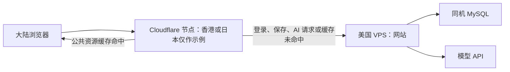
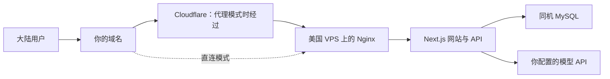

# AI 产品现场：海外 VPS + MySQL 上线指导手册

> 历史方案：用户于 2026-10-10 最终选择中国大陆服务器承载，本手册不再作为当前部署执行入口。最新决策见 [ADR-0007](adr/0007-v142-mainland-server-launch.md)；下方保留海外路线说明供参考。

更新日期：2026-10-10；套餐与官方资料核验于 2026-10-08。适用对象：第一次部署网站、主要希望在面试中展示作品的产品经理。

本手册采用“一台海外 VPS 运行网站与 MySQL，先直连验收，再对比 Cloudflare”的试验路线。截图套餐尚未购买，服务器尚未连接；下方是操作说明和实施目标，不是已完成部署的报告。

## 朋友那句话与实际成本

用户已澄清朋友说的是“美国服务器 + Cloudflare 做 CDN 分发到香港/日本 + 阿里云域名”，最后一项不是另一台阿里云服务器。基础架构只租一台美国 VPS：它运行网站，也可以运行现有 MySQL；阿里云负责域名注册，Cloudflare 提供访问代理和缓存节点。

以请求实际接入香港或日本节点为例：



“分发”指节点可以保存并返回可缓存的图片、JS、CSS 等资源；缓存未命中或需要网站处理的请求再转回美国。网站程序与数据库仍在美国，不自动搬到香港或日本，也不需要用户再租当地机器。动态请求经 Cloudflare 转发也可能改善体验，但不能仅凭缓存原理保证一定更快。[官方 CDN 架构](https://developers.cloudflare.com/reference-architecture/architectures/cdn/)、[默认缓存行为](https://developers.cloudflare.com/cache/concepts/default-cache-behavior/)

“香港/日本”仍需区分实际接入结果和固定线路承诺：普通 Cloudflare 接入使用 Anycast 网络路由，不提供一个免费固定城市开关；不能把朋友一次实测快推导成本站所有大陆网络都走同一节点。如果朋友另有线路优化配置，当前没有资料判断，不能自行补全。[官方 Anycast 说明](https://www.cloudflare.com/learning/cdn/glossary/anycast-network/)

| 项目 | 基础路线的费用 |
| --- | --- |
| 美国 VPS | 截图为 35.99 美元年付 |
| 阿里云域名 | 以实际域名首年及续费订单为准 |
| Cloudflare | Free 基础 CDN 套餐为 0；不默认购买付费附加服务 |
| 同机 MySQL | 不另购数据库服务，使用 VPS 的内存和磁盘 |
| 模型 API | 另计，CDN 不抵消模型调用费 |
| 实施与维护 | 首次 Linux 部署、登录/HTTPS 配置及日后更新需要时间；已有 MySQL 可省掉 PostgreSQL 迁移工作，但不能称为零实施成本 |

Cloudflare 免费计划信息见[官方 Free 计划](https://www.cloudflare.com/plans/free/)。不额外购买香港/日本服务器、阿里云服务器或独立云数据库，是这条基础路线的成本边界。

下方手册同时包含起步步骤、故障排查与后续维护，不能把每项说明理解为购买前必须全部完成的任务。部署实施应先核对现有代码在该链路的实际缺口，再明确工作量；尤其长生成的代理兼容需要单独评估。用户本轮要求解释方案和成本，不继续推进购买或部署。

## 低价 VPS 能否运行本网站：技术可行性与证据边界

2026-10-10 重新核对当前代码后的判断：截图 VPS 的机器类型和管理权限支持这类部署，网站不需要 Vercel 专属运行环境；但 2 GB 只是紧凑候选，尚未通过该配置下的实际运行验收，不能称为已经证明足够的购买推荐。

网站运行时，用户浏览器显示界面；服务器处理登录、项目、消息和成果，MySQL 保存这些数据；AI 请求通过 API 发给外部模型服务。`src/lib/ai.ts` 使用外部 API 客户端，`src/lib/mysql.ts` 使用 MySQL 连接池；当前 Next.js 本机官方指南支持 Node 服务自行部署。因此本站不在 VPS 上训练或运行大模型，无需为这条路线购买 GPU。

| 截图资源 | 对本网站意味着什么 | 当前判断 |
| --- | --- | --- |
| 2 vCPU | 处理网页请求、登录、数据操作与 AI 请求转发 | 少量演示的合理候选，实际 CPU 性能与响应速度未测 |
| 2 GB 内存 | 操作系统、网站进程、MySQL 和入口程序共同使用 | 最需要验证的资源，尚无本站峰值用量数据 |
| 35 GB SSD | 放系统、应用、数据库、日志及临时部署文件 | 少量文字成果预计可作为起步空间，实际部署占用和增长未测 |
| Root、IPv4、KVM | 可以管理系统、安装服务并建立公网网站入口 | 官方规格满足管理与部署条件；实际软件版本仍需核对 |

这些是基于代码结构和套餐规格的工程判断，不是压测结论。MySQL 缓存及连接会消耗内存，不能把 2 GB 全算给网站，也不能直接照搬专用数据库机器的内存配置。[MySQL 官方内存说明](https://dev.mysql.com/doc/refman/9.7/en/memory-use.html)、[套餐规格](https://www.racknerd.com/specials/)

还要分清两种消耗：生成正式运行包的“构建”可能比平时提供网页更吃内存。若只是构建失败，可以在匹配架构的其他 Linux 环境构建；若网站和 MySQL 平时运行就挤满内存，则需要调整配置或增加资源。不要把这两种失败归为同一个“机器带不动”。

大陆连通性与 Cloudflare 长生成超时是另外两个问题：内存更多不能自动改善跨境线路，也不能消除代理等待响应的限制。现有新工作台累计完整模型回复才返回，代码允许等待 600 秒；Cloudflare 默认读取超时 125 秒，长时间没有响应可能失败。该行为需在启用代理时适配，不能以加购 VPS 内存替代。[Cloudflare 限制](https://developers.cloudflare.com/fundamentals/reference/connection-limits/)

证据应分三层：当前业务已通过本机 MySQL/replay 发布闸；当前代码结构支持自行部署的方向；这款 2 GB VPS 上的生产内存、Linux 环境及真实模型/大陆网络仍未验收。已有业务回放不能替代后两项。

资源验证以本人单人完成全流程为起点，记录网站与数据库同时运行时的峰值内存、磁盘、进程退出与响应；再按实际试用人数增加负载，不把数据库连接池上限当用户上限。当前执行环境未发现可直接使用的 Docker，WSL 也未配置可用 Linux 环境，本轮未安装虚拟化组件或执行限制为 2 GB 的测试。不要求用户在这些证据缺失时先年付购买。

## 起步步骤：选择路线后再使用

1. 购买前，用自己的宽带和手机流量比较机房测试页面，查看套餐可选位置及最终价格。
2. 判断能否接受年付 35.99 美元、默认不退款的试验成本，再自行下单。
3. 购买域名，注册 Cloudflare，保存 VPS 的实际 IP 和控制台入口。
4. 给 Agent 提供服务器访问途径及域名信息，由 Agent 完成服务器、数据库、网站和 HTTPS 配置。
5. 在大陆普通网络上亲自验收完整流程；直连能用后，再比较 Cloudflare 代理。
6. 面试前检查网站和备份，准备一份已经完成四环成果的样例项目。

你当前只需要完成第 1 步。不要为了购买服务器，先学习数据库安装或 Linux 运维。

## 一、我们准备搭建什么



| 名称 | 你可以怎样理解 | 本方案中的用途 |
| --- | --- | --- |
| VPS | 租来的、持续开机的 Linux 电脑 | 运行网站和数据库 |
| MySQL | 网站自己的数据存储程序 | 保存账号、项目、聊天和成果 |
| 域名 | 网站地址 | 让面试官通过容易记住的地址访问 |
| DNS | 把域名对应到访问地址的服务 | 可交给 Cloudflare 管理 |
| Nginx | 网站的入口程序 | 处理 HTTPS，再把请求交给 Next.js |
| Cloudflare CDN | 公共资源缓存及访问代理 | 缓存图片、JS、CSS；转发动态请求 |
| SSH | 远程登录服务器的方式 | 供你或 Agent 安装、更新和排查 |

阿里云购买域名，不影响后来使用 Cloudflare 管理 DNS；域名所有权仍在你的阿里云账号。Cloudflare 橙云代表网页请求经过它，灰云（DNS-only）代表浏览器直接访问源服务器。数据库只供服务器内部的网站程序连接。[Cloudflare 代理说明](https://developers.cloudflare.com/dns/proxy-status/)

普通 Cloudflare 免费网络不保证固定经过香港，也不包含中国大陆 China Network。首页快、静态资源快，不等于登录、保存和 AI 生成已经顺畅；后面会分别验收。[中国网络说明](https://developers.cloudflare.com/china-network/)、[缓存行为](https://developers.cloudflare.com/cache/concepts/default-cache-behavior/)

## 二、截图中的 RackNerd 套餐怎么样

结论：可以列为低预算面试作品的试验候选；2 GB 是紧凑配置，需要控制构建、日志和数据库内存。当前选中的纽约机房不要只凭默认选项决定，先比较可选机房的实测。

| 截图项目 | 实际含义与判断 |
| --- | --- |
| 2 vCPU | 适合尝试小规模网站；不是两颗独占物理 CPU 的承诺 |
| 2 GB RAM | 网站和 MySQL 共用；不能据此保证并发人数或构建一定成功 |
| 35 GB SSD RAID-10 | 要容纳系统、依赖、构建、数据库及日志；RAID 不是误删恢复或离机备份 |
| 5000 GB 月流量 | 对少量文字型演示预计宽裕；不是大陆访问速度保证 |
| 1 Gbps 网口 | 服务器网络端口规格，不代表你在大陆能获得该下载速度 |
| 1 个 IPv4 | 足够本轮一个网站使用 |
| Ubuntu 24.04 64 Bit | 可以作为 Linux 部署起点，具体软件版本由 Agent 核对 |
| New York | 当前选择，不是本手册已推荐的最终机房 |
| 35.99 美元年付 | 一次支付全年，折算约 3 美元/月；人民币以实际结算和手续费为准 |

官网当前同款规格与截图一致，FAQ 写明该特价同价续费；最终仍保存购买时订单摘要。另有 4 GB / 3 vCPU / 60 GB、59.99 美元/年，差额为每年 24 美元；预算紧时不必仅为“更大”直接升级。[官方套餐页](https://www.racknerd.com/specials/)

**这不是可退款的年付试用。** 官方默认付款后不退款，只对个案酌情处理。官方建议希望短期试用者选择月付，但这不证明截图这款特价允许月付。年付前确认自己能够承担效果不理想仍付全年费用的结果。[服务条款](https://www.racknerd.com/terms-of-service)、[退款知识库](https://my.racknerd.com/index.php?language=english&rp=/knowledgebase/9/Do-you-have-money-back-guarantee-Or-offer-refunds.html)

本次未能核实购物车里全部机房选项、机房加价和售后迁机条件，不能保证该价可选洛杉矶。选择位置后重新看右侧总价，不根据“多个机房可用”推定每个机房同价。

## 三、购买前：怎样测试大陆访问

### 1. 比较三个官方测试入口

| 机房 | 官方公开测试 IP | 页面 |
| --- | --- | --- |
| 纽约 | `192.3.81.8` | [纽约 Looking Glass](https://lg-ny.racknerd.com/) |
| 洛杉矶 DC-03 | `107.174.51.158` | [洛杉矶 Looking Glass](https://lg-lax03.racknerd.com/) |
| 圣何塞 | `192.210.207.88` | [圣何塞 Looking Glass](https://lg-sj.racknerd.com/) |

这些是公开测试地址，不是你购买后实际获得的服务器 IP。西海岸值得比较，但不能仅凭地理位置断言一定比纽约快；测试 IP 也不能保证购买后的主机具有相同表现。

### 2. 你按这个顺序操作

1. 关闭 VPN/代理，用日常宽带打开三个测试页面。
2. 每个页面先下载它提供的 **10 MB** 文件；不用一开始就下载 1 GB。
3. 记录页面是否顺畅打开、10 MB 大约下载多久、是否中断。
4. 手机关闭 Wi-Fi，改用流量，重复测试。
5. 晚上再重复一次；若某机房经常打不开或下载卡住，降低其优先级。

如果愿意补充延迟记录，在 Windows PowerShell 分别运行：

```powershell
ping -n 20 192.3.81.8
ping -n 20 107.174.51.158
ping -n 20 192.210.207.88
```

三个命令只查询公开测试地址。记录平均延迟和丢包；ping 被限制时仍可能正常浏览，所以不能只按 ping 成败做购买决定。Looking Glass 中运行的 ping/MTR 通常是机房发起的测试，也不要把它当作你家宽带发起的结果。

记录模板：

| 日期/时段 | 网络运营商 | 机房 | 页面能打开？ | 10 MB 完成时间 | ping 丢包/平均延迟 | 感受 |
| --- | --- | --- | --- | --- | --- | --- |
| 例：晚间 | 你的宽带 | 纽约 | 待填写 | 待填写 | 待填写 | 待填写 |

购买前测试主要比较直连和下载，Cloudflare 模式与本站动态功能要等正式部署后再测。若所有候选都很不稳定，不要寄希望于 Cloudflare 一定补救。

## 四、购买与账号准备：由你操作

### VPS 购买页

- 套餐保持你预算允许的 2 GB；先看实际可选机房，与上一步表现结合选择。
- 系统可以选择截图中的 Ubuntu 24.04 64 Bit。
- `Server Label` 是便于你识别机器的名字，例如 `ai-pm-demo`，以后可以改，不是网站域名。
- 1 个 IPv4 即可；不因界面推荐就增加控制面板、管理服务或其他付费项目。
- 最后核对：年付金额、机房加价、续费、付款方式及退款条款。保存订单摘要和付款凭据。

开通后，从邮件或控制台找到：实际服务器 IP、SSH 端口、登录用户名、控制台/VNC 入口、续费日期。控制台中的“重装”会影响服务器数据；已经部署后不要把重装当普通重启。

### 域名与 Cloudflare

1. 在阿里云查询并购买你选定的域名，核对续费价并按购买要求完成实名。
2. 创建 Cloudflare 免费账号，把域名添加进去。
3. 后续按 Cloudflare 给出的两条 nameserver 地址，在阿里云修改 DNS 服务器；不是仅添加两条普通 DNS 记录。
4. 原有邮箱相关记录若存在，要先保留；新域名通常更简单。

`pmstage.cn` 只是之前的命名建议，本手册未确认可注册。[Cloudflare 接入外部域名指南](https://developers.cloudflare.com/fundamentals/manage-domains/add-site/)

### 交给 Agent 的信息

你可以先提供：实际 VPS IP、系统、机房、域名、准备部署的代码版本，以及模型供应商。访问权限优先通过 SSH 密钥建立：Agent 给出公钥，你在服务器上安装；私钥留在执行部署的一侧。不要把 root 密码、API Key 或完整 `.env.local` 写进这份手册、Git 或截图。

若首次只支持密码登录，由你先在本机 SSH/供应商控制台完成初始登录，再建立部署公钥。密码输入时终端不显示字符是正常现象。具体连接方式到机器开通后按实际环境处理。

## 五、交给 Agent 的部署任务

下面是 Agent 需要交付的工作，你不用独自复制一串安装命令。服务器开通后，可复制文末的任务描述。

### 1. 确认版本与资源

检查实际内存、剩余磁盘、CPU 架构、系统和服务端网络；记录确定采用的 Node、MySQL 与代码提交版本。

**本仓库有一个必须提前处理的版本边界：** `src/lib/mysql-config.ts` 当前将初始化版本锁在已验收的 **MySQL 9.7.2**。不能简单安装 Ubuntu 默认 MySQL 或 MariaDB 就认为兼容。优先核实、安装对应版本；若必须换版本，由 Agent 提出具体适配和相关回归，不能只删掉版本检查。

Node 也需统一：仓库旧部署 `.node-version` 为 22.16.0，本机进度记录为 24.21.0；实际云端选择需以已通过生产构建的版本和 Linux 可用性为准，不盲目沿用旧 Render 配置。

### 2. 建立持久运行与数据库

- 安装并设置 MySQL 开机启动，数据保存在持久目录。
- 使用独立云端空库；本机 MySQL 及现有数据保持原样。
- 用一次性管理员身份运行仓库初始化与迁移，网站运行时使用专用应用账号。
- 网站进程以普通部署用户运行，由 systemd 管理，重启系统后自动恢复。
- Next.js 只监听本机，Nginx 对外提供 HTTP/HTTPS；MySQL 不对公网开放 3306。
- 配置系统与供应商防火墙时保留已验证的 SSH/控制台恢复通道，避免把自己锁在外面。

### 3. 处理 2 GB 内存的构建

在生产模式运行与在服务器编译，是两个不同的内存需求。建议串行初始化、安装依赖和构建，先测资源；必要时使用少量 swap 作为缓冲，swap 不是替代物理内存的提速方案。

若构建内存不足，改为在匹配目标架构的 Linux 环境构建，再上传运行产物。不要直接把 Windows 的 `node_modules` 或构建目录当成可靠的 Linux 部署包。本仓库尚未配置 `standalone`；若采用它，Agent 需要按本机 Next.js 16.3 文档配置，并包含 `public` 与 `.next/static`。

2 GB 验证不通过时，先明确是构建问题还是运行问题；只为构建问题直接加购更大机器未必必要。该机器调用远程模型 API，不在本机运行大模型。

### 4. 配置应用与 HTTPS

| 配置组 | Agent 需要确认的内容 |
| --- | --- |
| MySQL | 本机连接地址、端口、数据库名、应用账号和强密码 |
| 初始化身份 | 独立管理员权限；不放进网站运行时配置 |
| 登录 | 新的 `AUTH_SECRET`、生产域名、代理头/host 信任和 Cookie；实测登录后刷新 |
| 模型 | 显式设置 `AI_MODE`、供应商地址、模型及 API Key |
| 生产进程 | Linux 生产构建、持久启动方式、日志位置及重启行为 |

先显式设 `AI_MODE=replay` 跑低成本业务冒烟；它是确定性测试，不能当作真实模型质量验收，也不能向面试官冒充实时生成。测试稳定后再配置 live 做少量实际生成，费用上限另行确定。

先用浏览器信任的源站 HTTPS 证书跑通 DNS-only。Nginx 必须正确转发生产域名与 HTTPS 信息，不能只以“首页能打开”判断登录配置完成。

技术命令由 Agent 执行并解释结果，基本业务验收入口包括 `npm run db:init`、`npm run verify:mysql-init`、生产构建和与改动相符的非 LLM 回放。初始化先检查目标为空云端库，不能对本机或既有线上数据盲目执行。

## 六、先直连，再比较 Cloudflare

### 第一次：灰云 DNS-only

在 Cloudflare 添加域名到实际 VPS IP 的 A 记录，使用 DNS-only；`www` 如需使用，也正确配置。没有实际 IPv6 时不随意添加 AAAA。HTTPS 配好后，用域名验收登录、文件和生成。

此时 Cloudflare 提供域名解析，网页请求直接访问服务器。这一步是为了先确认源站正常，并记录直连体验。

### 第二次：橙云代理

把对应记录设为 Proxied，HTTPS 使用 **Full (strict)**；保留源站有效证书。公共静态资源可缓存，登录、私人项目和 API 明确不共享缓存，不启用全站 Cache Everything。[HTTPS 模式](https://developers.cloudflare.com/ssl/origin-configuration/ssl-modes/full-strict/)

用同样的大陆网络与同样的操作重复测试。浏览器可能保留旧解析或连接；先核对实际响应是否经 Cloudflare，再填写结果，不仅看刚切换按钮后的第一次访问。

### 必须处理的 125 秒问题

截至本次核查，Cloudflare 默认 Proxy Read Timeout 是 **125 秒**。它不是“所有请求总时长必须小于 125 秒”，但源站长时间不返回响应会触发 524。[官方连接限制](https://developers.cloudflare.com/fundamentals/reference/connection-limits/)

当前新工作台在服务端累计完整 AI 回复后才返回 JSON，上游超时 600 秒；因此超过约两分钟且无响应的生成可能在代理层先失败。正式使用橙云前，应评估真正的流式响应/及时心跳与关闭代理缓冲，或持久任务与进度轮询，并覆盖停止、失败、刷新恢复。仅调大 Nginx 超时不能消除 Cloudflare 限制。

若本轮先采用直连，仍需设置适合的 Nginx 与应用超时、停止和失败处理；不能因为绕过 Cloudflare 就省略基础可靠性。首次不急于把 API 拆到另一域名，避免新增登录 Cookie 与跨域问题。

## 七、大陆用户验收表：由你体验，Agent 记录证据

以下是本项目建议目标，不是 RackNerd 或 Cloudflare 的性能承诺。

| 操作 | 建议观察项 |
| --- | --- |
| 首页/入职体验 | 几秒内能开始操作，无长期空白或资源加载失败 |
| 注册、登录与刷新 | 登录成功且刷新保持身份，无循环跳回登录 |
| 项目与迭代 | 创建、加载、切换能完成，无明显持续卡顿 |
| 四环实际使用 | 各阶段至少完成一次对话和成果交付 |
| 文件与任务集合 | 确认、刷新读取、上下文加载、下载正确 |
| 长生成 | 覆盖超过两分钟的情况；无 524、假成功或永久生成中 |
| 停止与重试 | 页面状态收口，重试可继续，不破坏已有成果 |
| 重启服务器 | 网站和数据库恢复，账号、文件仍存在 |

在宽带与手机流量、白天与晚间分别对照；可重复同类操作 5—10 次，记录失败次数。模型思考时间单独记录，不把“AI 回复需要几十秒”都归因为网络。

| 网络/时间 | 模式 | 页面可操作时间 | 登录是否成功 | 保存/刷新是否成功 | 长生成结果 |
| --- | --- | --- | --- | --- | --- |
| 待填 | 直连 | 待填 | 待填 | 待填 | 待填 |
| 同一网络/相近时段 | Cloudflare | 待填 | 待填 | 待填 | 待填 |

若代理更稳定就采用代理；若直连更好，可以保留直连；若两种都不好，再考虑换具体机房线路。不要把“便宜”或“开了 CDN”当作已经通过大陆验收。

## 八、上线后你需要做的少量维护

- 保存续费日期；官方普通取消要求续费日前至少五天在客户区提交，建议提前两周决定。取消或重装前先备份。
- Agent 设置每日数据库导出，并复制到服务器之外；你需要知道备份位置。首次至少恢复到一个独立测试库，证明备份可用。
- 监控磁盘、内存和日志，建议磁盘使用接近 80% 时检查；预警值是我们设置的运维目标。
- 更新网站时先备份，保留上一个可运行代码版本；若含数据库迁移，不能只换旧代码当成完整回滚。
- 首发限制真实模型试用范围或设置额度，避免公开入口产生超出预算的模型费用。
- 面试前一天，关闭代理工具按面试使用方式走一次流程；保留一份真实已完成的样例和本机演示作为备用。

## 九、常见问题怎么判断

| 现象 | 优先检查 |
| --- | --- |
| 服务器 SSH 能连，网站打不开 | DNS、HTTPS、Nginx、网站进程、两层防火墙 |
| Cloudflare 报 524 | 长请求没有及时响应，尤其完整生成后才返回的聊天 |
| 首页正常但登录失败 | 生产域名、HTTPS/代理头、登录 Cookie、数据库应用账号 |
| 构建进程突然被终止 | 内存与 OOM；不要不看原因反复构建 |
| 文件突然不能保存 | MySQL 状态、磁盘、权限、错误日志 |
| 开代理变慢 | 在同一网络对照直连，核对实际路径和静态缓存 |
| 控制台提示重装能解决 | 先诊断、备份；重装会影响数据，不作为普通修复按钮 |

## 十、服务器准备好后，给 Agent 的任务描述

> 请按 `docs/deploy-overseas-vps-guide.md` 准备部署 AI 产品现场。目标是海外 VPS + 同机 MySQL，先 DNS-only 验收，再比较 Cloudflare；使用全新云端数据库，本机数据库不迁移、不清理。先检查实际主机配置、Node/MySQL 版本、生产配置和长请求限制，完成可审查的部署方案与资源检查，再在我已提供的访问权限和授权范围内实施。数据库仅供本机连接，网站使用应用账号；建立 HTTPS、持久运行、每日离机备份和更新恢复流程。先显式 replay 验收，少量 live 验证需说明假设、轮数与成本。记录宽带/手机网络上的完整操作与代理/直连对照，不以首页打开替代发布验收。

这段话用于购买开通后的下一阶段，不表示本手册已经执行上述操作。无需购买独立云数据库，也不要求本轮继续迁移 Supabase。

## 参考资料

- [RackNerd 套餐与条款核验](research/racknerd-vps-evaluation-2026-10-08.md)
- [海外 MySQL 与 Cloudflare 路线研究](research/v142-overseas-mysql-cloudflare-routes.md)
- 当前仓库 `src/lib/mysql-config.ts`、`.env.example`、`package.json` 和本机 `node_modules/next/dist/docs/` 的 self-hosting/output 指南。

本手册只记录当前研究与试做路径。实际机房选项、库存、价格和条款以购买当日订单及官方说明为准；当前没有主机上的容量或大陆链路实测结果。
